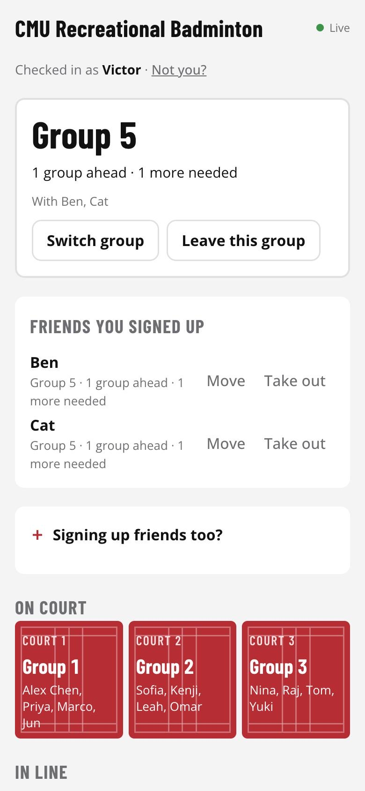
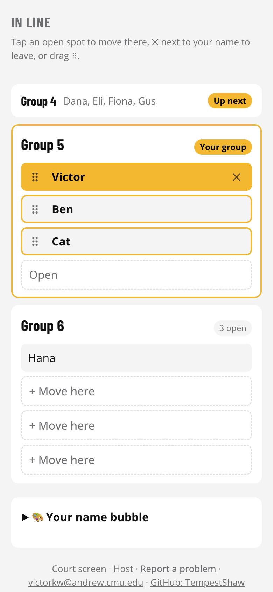
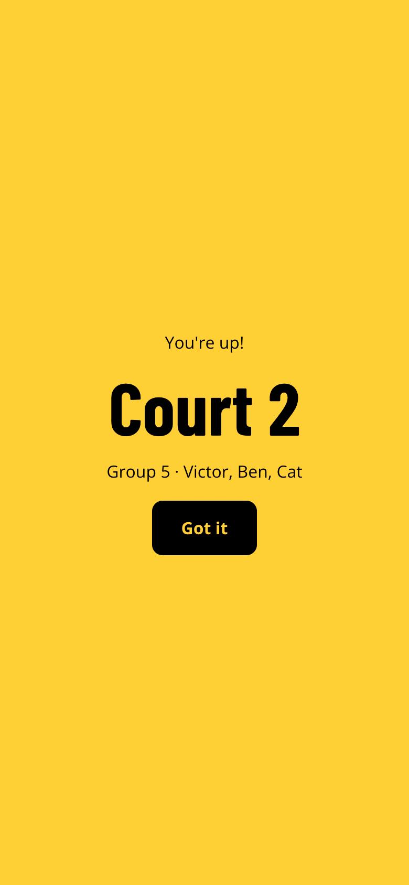

# CMU Recreational Badminton

Sign-up and court queue for CMU recreational badminton, replacing the shared
spreadsheet. Players check in on their phones, join a group of four, and get a
push notification when their group is called. A computer by the courts shows
the courts, the line and today's sign-up code.

**Live:** [cmubmt.vercel.app](https://cmubmt.vercel.app) ·
**Guide (PDF):** [docs/CMU-Badminton-Guide.pdf](docs/CMU-Badminton-Guide.pdf)

<p>
  
  
  
</p>

## What it does

- **Check-in with a daily code** shown only on the court-side screen, so people
  sign up when they're actually at the courts. Names are unique for the day.
- **Groups of four, in line order.** A full group goes on the next free court
  automatically. A short group at the front keeps one free court for itself and
  can start anyway; full groups behind it use the other free courts.
- **Push notifications** (Web Push) when your group is first in line, when a
  court is held for your short group, and when you're called to a court.
  Works on Android and on iPhone from the Home Screen app (iOS 16.4+).
- **Sign up friends** in one go, move people between groups by tapping or
  dragging, and see the day's finished games.
- **Fair-play limits:** one spot per person (the host page flags anyone
  signed up twice), one phone can hold spots for at most three friends,
  per-network rate limits, and 10 wrong host PINs lock host sign-in on that
  network for 10 minutes.
- **Name bubbles:** each player can give their name in the line a color and a
  pattern (12 × 8 SVG combinations); the phone remembers it for next time.
- **Three screens:** the phone page (`/`), the court-side screen (`/kiosk`,
  unlocked once with the host password) and the host page (`/host`).

## How it works

```
phones ──poll /api/state (CDN-cached ~2 s)──▶ Vercel functions ──▶ Upstash Redis
       ──POST /api/action ──────────────────▶   (one JSON key,
                                                 compare-and-set)
       ◀──── Web Push (APNs / FCM) ───────────── sent after each change
```

- **One state key, optimistic concurrency.** The whole queue is one JSON value
  in Redis. Every action reads it, applies a pure function from
  [`lib/queue.js`](lib/queue.js) / [`lib/session.js`](lib/session.js), and
  writes back with a Lua compare-and-set; if someone else wrote first it backs
  off at random and retries ([`lib/actions.js`](lib/actions.js)). Tested with 60
  people tapping at the same instant.
- **Cheap polling.** `/api/state` is cached at the CDN for two seconds, so Redis
  sees about one read every two seconds however many phones are watching.
  Phones poll less often when idle and stop when hidden. In the Home Screen
  app, pulling down re-reads the queue (at most once every three seconds).
- **Stays up to date.** Every reply names the deployment that sent it; a page
  left open reloads itself after a deploy once nobody is touching it.
- **Privacy.** Each phone keeps a random secret id; the public state only shows
  a hash of it. Today's code never appears in the public state.
- **No framework.** Plain ES modules in [`public/js`](public/js), bundled by
  esbuild at deploy time ([`scripts/build.mjs`](scripts/build.mjs)) into
  content-hashed files that phones cache for a year.

## Project layout

| Path | What's there |
| --- | --- |
| `api/` | Vercel functions: `state` (read), `action` (every write), `subscribe`, `pushtest`, `report` |
| `lib/queue.js` | Queue rules: groups, courts, moving people, who to notify |
| `lib/session.js` | Today's code, check-in, unique names, signing up friends |
| `lib/actions.js` | Permissions per action and the compare-and-set retry loop |
| `lib/auth.js`, `lib/validate.js` | Host password / court-screen token, input checks |
| `lib/push.js`, `lib/store.js` | Web Push sending, Redis (or in-memory) storage |
| `public/` | The three pages, their scripts, styles, service worker and icons |
| `scripts/` | Local dev server, production build, icon drawing |
| `docs/` | The user guide (HTML source, screenshots, PDF) |

## Running it

```bash
npm install
HOST_PIN=1234 npm run dev        # http://localhost:3000, data kept in memory
```

Without Redis settings the dev server keeps everything in memory, and without
VAPID keys push notifications are simply off.

### Deploying (Vercel + Upstash)

1. Create a Vercel project from this repo and add **Upstash for Redis** from
   the Vercel Marketplace (Storage tab); it sets `KV_REST_API_URL` and
   `KV_REST_API_TOKEN`.
2. Generate push keys with `npx web-push generate-vapid-keys` and set these
   environment variables:

   | Variable | Value |
   | --- | --- |
   | `HOST_PIN` | the host password |
   | `VAPID_PUBLIC_KEY`, `VAPID_PRIVATE_KEY` | from the command above |
   | `VAPID_SUBJECT` | your site URL or `mailto:` address |

3. Deploy. Vercel runs `npm run build` and serves `dist/`.

`npm run manual` re-prints the PDF guide from `docs/manual/manual.html` with
headless Chrome.

## Contact

Made by Victor · [victorkw@andrew.cmu.edu](mailto:victorkw@andrew.cmu.edu) ·
[github.com/TempestShaw](https://github.com/TempestShaw)
